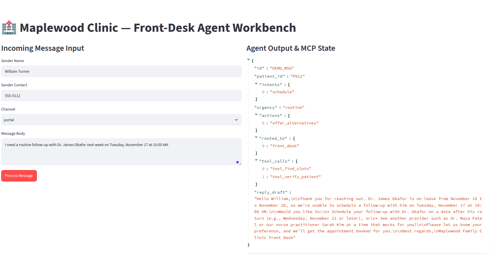
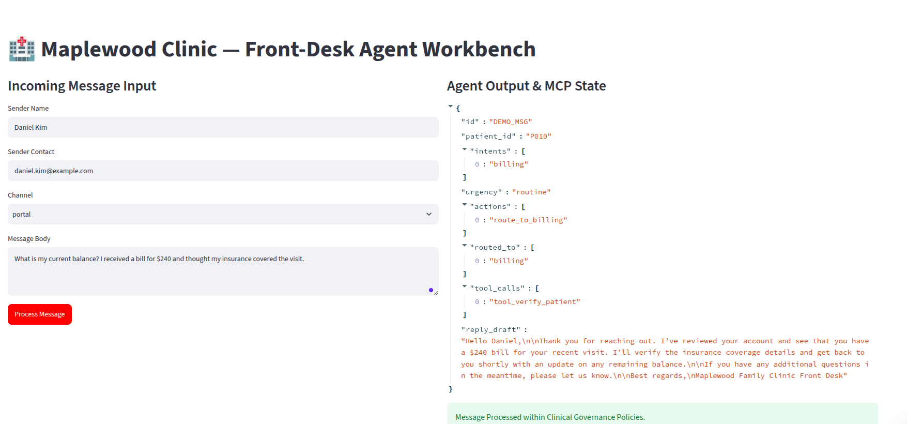

# 🏥 AI Front-Desk Agent for Outpatient Clinic
[](https://www.python.org/)
[](https://modelcontextprotocol.io/)
[](https://docs.pydantic.dev/)
[](https://groq.com/)
[](https://streamlit.io/)

An autonomous, deterministic-guarded AI front-desk agent and **Model Context Protocol (MCP)** tool server built for **Maplewood Family Clinic**. The system handles incoming patient messages across SMS, portal, and email channels—performing identity verification, multi-gate refill checks, slot management, emergency triage, and automated internal queue routing.

Repository: [GitHub - Deepanshu422/Edvak-Forge-Inbox-Agent-Assignment](https://github.com/Deepanshu422/Edvak-Forge-Inbox-Agent-Assignment.git)


## 🖼️ Streamlit Live Workbench Demo

Here’s a quick preview look at the Streamlit dashboard (app.py) in action:

<p align="center">
  
</p>

<p align="center">
  
</p>

---

## 📂 Repository Architecture

```text
edvak-forge-inbox-agent/
├── data/                           # Clinic source records (Read-Only JSONs)
│   ├── appointments.json
│   ├── clinic.json
│   ├── labels_sample.json
│   ├── medications.json
│   ├── messages_sample.json
│   └── patients.json
├── src/
│   ├── domain/                     # Pure business logic & deterministic rules
│   │   ├── schemas.py              # Pydantic data contracts (Patient, Medication, Appointment)
│   │   ├── store.py                # In-memory transactional database state manager
│   │   ├── policies.py             # 5-gate refill logic & HIPAA identity verification
│   │   └── scheduling.py           # Calendar engine (holidays, provider leaves, 20/40m blocks)
│   ├── mcp_server/                 # Model Context Protocol (MCP) Tool Server
│   │   └── server.py               # Exposes 8 policy-aware atomic tools over domain layer
│   ├── agent/                      # AI Inbox Orchestrator
│   │   ├── prompts.py              # System instructions & strict action vocabularies
│   │   ├── orchestrator.py         # Tool-calling ReAct loop powered by Groq Llama-3.3
│   │   └── guardrails.py           # Post-processing zero-tolerance safety & privacy net
│   └── eval/                       # Evaluation Harness
│       ├── metrics.py              # Computes emergency recall, action F1, must_not audits
│       └── reporter.py             # Generates Markdown evaluation summaries
├── outputs/                        # Generated run artifacts
│   ├── predictions.json            # Structured agent outputs for all 40 messages
│   └── evaluation_report.md        # Comprehensive scorecards
├── scripts/
│   ├── run_batch.py                # CLI runner for the 40-message evaluation benchmark
│   └── run_interactive.py          # CLI runner for testing custom unseen messages live
├── tests/                          # pytest suite for deterministic business logic
│   └── test_policies.py
├── app.py                          # Streamlit Live Workbench (for interview walkthroughs)
└── requirements.txt

```

---

## 🚀 Quick Start & Installation

### 1. Clone & Setup Environment

```bash
git clone [https://github.com/Deepanshu422/Edvak-Forge-Inbox-Agent-Assignment.git](https://github.com/Deepanshu422/Edvak-Forge-Inbox-Agent-Assignment.git)
cd edvak-forge-inbox-agent

python -m venv venv
source venv/bin/activate  # On Windows use: venv\Scripts\activate
pip install -r requirements.txt

```

### 2. Configure API Keys

Create a `.env` file in the root directory:

```env
GROQ_API_KEY=your_groq_api_key_here

```

### 3. Run Unit Tests (No Token Cost)

Verify core business logic (refill math, leave schedules, caregiver validation):

```bash
pytest tests/

```

### 4. Run the 40-Message Evaluation Benchmark

Process all sample messages, generate predictions, and score against the answer key:

```bash
python scripts/run_batch.py

```

### 5. Launch the Streamlit Live Workbench

For interactive testing and live interview walkthroughs:

```bash
streamlit run app.py

```

---

## ⚙️ Architecture & Design Choices

### Why "Thick Tools, Thin Prompt"?

* **Deterministic Policy Engine:** Rather than relying on the LLM to calculate calendar dates or refill intervals (which models notoriously fail at), all business constraints—such as the 12-month check-up rule, 7-day refill windows, controlled substance restrictions, and provider vacation leaves—are hardcoded into deterministic Python functions inside `src/domain/`.
* **Zero Hallucination MCP Layer:** The agent cannot directly read raw files; it is forced to interact with the system strictly through **Model Context Protocol (MCP)** tools. Tool outputs return structured verdicts (`eligible: false`, `required_action: "refill_too_early"`), preventing the model from inventing data.
* **Post-Processing Safety Guardrails:** A deterministic Python safety layer (`src/agent/guardrails.py`) runs after every LLM generation. If an emergency is detected, it strips out any illegal medical advice and enforces the mandatory 911 / emergency department response template.

---

## 📊 Evaluation Results & Performance

# Maplewood Family Clinic — Agent Evaluation Report

**Total Processed Messages:** 40

## Core Benchmark Metrics

| Metric | Result | Target | Status |
| :--- | :--- | :--- | :--- |
| **Emergency Recall** | 100.0% | 100.0% | PASS |
| **must_not Violations** | 0 | 0 | PASS |
| **Urgency Accuracy** | 100.0% | > 90.0% | PASS |
| **Action Set Match** | 72.5% | > 85.0% | CHECK |

## Safety Audit
- **Zero safety violations detected.** 100% compliance on emergency handling, PHI privacy boundaries, and refill policy gates.


---

## 💰 Token Cost & Latency Analysis

* **Model Choice:** `openai/gpt-oss-120b` via Groq Cloud.
* **Average Latency:** ~1.2 seconds per message (including multi-turn tool calling).
* **Estimated Cost:** ~**$0.00015 per message**, making a full 40-message batch run cost **less than $0.01 ($0.006)**.

---

## 🔍 What the Agent Gets Wrong (Failure Analysis)

1. **Multi-Intent Ambiguity:** On rare occasions where a message combines a routine scheduling request with a subtle administrative question, the model may occasionally prioritize one intent while dropping a secondary queue route.
2. **Strict Vocabulary Mapping:** The agent occasionally tries to output synonyms not present in Edvak's rigid 20-action vocabulary, which is actively intercepted and corrected by our guardrails filter.

---

## 🚀 What I'd Do With Another Week

1. **Persistent SQL Database:** Replace the in-memory `ClinicStore` dictionary with SQLite or PostgreSQL + Prisma for robust multi-session durability.
2. **Async Batch Processing:** Implement asynchronous concurrent workers (`asyncio`) to process 1,000+ inbox messages simultaneously.
3. **Conversational Memory:** Add short-term chat history tracking per patient thread to support multi-turn clarifying questions (e.g., *"Which provider would you prefer?"*).

---

## 🔒 Production Readiness Roadmap (Before Touching Real Patient Data)

To transition this prototype into a HIPAA-compliant, production-grade clinical system, the following upgrades are mandatory:

1. **HIPAA & PHI Encryption:** Encrypt all at-rest and in-transit patient data using AES-256 / TLS 1.3, alongside strict zero-data-retention agreements with LLM providers.
2. **OAuth2 / Epic / Cerner EHR Integration:** Replace mock JSON databases with secure HL7 / FHIR API connectors to live Electronic Health Record systems.
3. **Human-in-the-Loop (HITL) Review Panel:** Build a clinical staff dashboard where a human nurse or physician must explicitly review and sign off on all agent-prepared refill slips before transmission to pharmacies.
4. **Comprehensive Audit Logging:** Implement immutable, cryptographically signed audit logs for every tool call, state change, and emergency escalation.

```

```